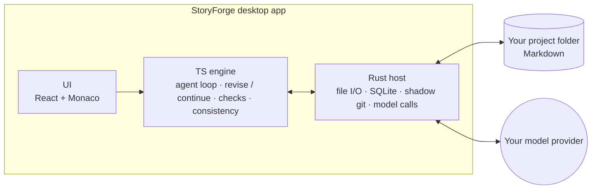

<div align="center">


# StoryForge

**An AI writing IDE for long-form fiction**

Open your novel project locally and work with an agent that searches the whole manuscript on its own: review, revise, draft.<br />
Every change the AI proposes arrives as a word-level diff; in the default Ask mode, nothing touches your manuscript until you accept it.

[](https://github.com/XZZKANY/StoryForge/releases/latest)
[](https://github.com/XZZKANY/StoryForge/releases)
[](#download)
[](LICENSE)
[](https://github.com/XZZKANY/StoryForge/stargazers)

[**Download**](#download) · [**Quick start**](#quick-start) · [**Features**](#features) · [**FAQ**](#faq) · [**Contributing**](#contributing)

[简体中文](README.md) · **English**

</div>

<br />

<picture>
  <source media="(prefers-color-scheme: dark)" srcset="docs/assets/readme/hero-dark.webp" />
  
</picture>

<p align="center"><sub>The interface is in Simplified Chinese. The sample novel and the AI replies in these screenshots are demo content.</sub></p>

## Why StoryForge

The hard part of a long novel is rarely writing one beautiful paragraph. It is remembering, eighty chapters in, what you planted in chapter three, who is where, and who is holding the key.

A general chat assistant cannot see your whole book, so you keep pasting the backstory again. One-click generation pushes the author out of the work. StoryForge takes a third path:

- **You are the author; the AI is your editor and assistant.** It reads, finds problems, suggests fixes and drafts, but by default you decide what goes into the text: in Ask mode, you accept every patch.
- **The whole book is searchable.** The agent browses folders, reads chapters and searches the manuscript on its own, and answers with your outline and character notes in mind.
- **Manuscript changes are visible and reversible.** Edits arrive as patches: word-level diffs, a snapshot before writing, one-click undo after.

## Features

### A conversational agent that searches the whole book on its own


- Ask in Chinese, for example: 「审一下第 5 章的节奏」 (review the pacing of chapter 5), 「第 12 章和第 3 章的设定对得上吗」 (do chapters 12 and 3 agree?), 「起草第 7 章」 (draft chapter 7).
- The agent decides which files to read (list, read, search across the book) and logs every step in the conversation, which you can expand.
- Multi-perspective review, targeted revision, drafting new chapters, cross-chapter and deep consistency checks, all in one conversation.
- When you ask in Chinese for a new chapter (「起草第 7 章」「写下一章」), it shows you a chapter brief first, then writes, self-checks, and hands the result over as a patch. Other phrasings may have the agent draft without a brief.

### Word-level diffs: by default, nothing is written until you accept


- Every AI edit to the manuscript is a patch. Accept all of it, accept it hunk by hunk, reject it, or reject it and tell the AI what to do instead.
- A snapshot is taken before writing, and an undo button appears afterwards. The AI changes only the spans it points to and keeps your edits elsewhere; if the text a patch targets has been changed by you, the write is refused.
- Permissions are set per project: **Read-only** (answers only and never edits the manuscript; tools can still update files under `.storyforge/`, such as the serial plan and canon caches), **Ask** (you accept every patch) or **Auto** (writes without a click, still snapshotted and undoable).

### Inline help: Ctrl+K to rewrite, Ctrl+Shift+K to continue


- Select a passage, press **Ctrl+K** and say "make it more restrained". The rewrite appears right below the original: **Alt+Enter** accepts, **Esc** discards.
- Press **Ctrl+Shift+K** at the cursor to continue the scene in the same voice, optionally with a direction such as "move to the conflict".

### The worldline observatory: keep the story straight


<p align="center"><sub>In the screenshot, the crew-count entry is only an illustration: for now, only contradictions in life and death, relationships or backstory are flagged for your decision; changing states such as headcount follow the newer chapter.</sub></p>

- **Fact ledger**: after you accept the whole-chapter patch for a chapter written through the chapter-brief flow, the checker also records facts such as identities, who holds what and how many people were on the ship, each with its source. Life-and-death, relationship and backstory contradictions are flagged for you to decide which chapter wins; changing states such as headcount or who holds what follow the newer chapter. Hand-written or earlier chapters can be backfilled in the observatory.
- **Plot threads**: threads registered in canon (written in by you, or proposed by the agent and merged once you confirm), with the chapter where each was planted and the latest chapter that advanced it; overdue ones are flagged.
- **Characters and entities**: characters and entities registered in canon, with canonical names, aliases, where they appear and how many times.
- Plot threads and characters are counted by fixed rules, with no model calls. Facts in the ledger are extracted in passing by the model call that runs the chapter check; backfilling older chapters calls the model once per chapter. Ask the AI to dig deeper when something looks off.

### Book overview: know what to write today


Cover, synopsis, progress, where the last chapter stopped, and up to two plot threads that have gone quiet or are due, all on one page. Continue the current chapter or have the AI draft the next one from here.

### Version history and undo


Every AI write to the manuscript leaves a checkpoint you can compare or restore at any time, except files ignored by the project's `.gitignore` and untracked files larger than 2 MB. Snapshots live in a separate shadow repository on this machine and never touch your own git; after the project folder is moved or renamed, older versions may not be recoverable.

### And more

| Feature | What it does |
| --- | --- |
| Idea notes | Jot down an idea from the sidebar; it is saved to `灵感.md` in the project root and can be viewed and edited right in the editor |
| Serial plan | Chapter goals and progress live in `.storyforge/serial-plan.json` and inform drafting |
| Knowledge inbox | Setting entries proposed by the agent wait in an inbox until you approve them |
| Book breakdown | Break a reference novel down into a structure report, saved as Markdown and JSON |
| Custom agent | Describe tone, review standards and style taboos in `.storyforge/agent-instructions.md` |
| Editor | Command palette, full-text search, tabs, three layouts (Ctrl+1/2/3), light and dark themes |

## Download

| Platform | Installer | Notes |
| --- | --- | --- |
| Windows 10 / 11 (64-bit) | [**Latest release**](https://github.com/XZZKANY/StoryForge/releases/latest) | NSIS installer, about 33 MB |

- Requires Microsoft Edge WebView2, which ships with Windows 11 and is usually present on Windows 10; if it is missing, the installer downloads it during setup.
- The installer is not code-signed yet. If Windows SmartScreen appears, click "More info" and then "Run anyway".
- Only Windows is supported for now.

## Quick start

1. **Install and open** StoryForge.
2. **Set up a model**: in Settings → Model service, pick a provider, paste your API key and save; it takes effect at once. For OpenAI-compatible services, add `/v1` to the service address (see Supported models below). The key is encrypted on your machine.
3. **Open a project**: open a local folder from the library, or create a new project.
4. **Start working**: describe what you need in the chat on the right, or select a passage in the editor and press **Ctrl+K**.
5. **Review the patch**: accept it if you like it; otherwise reject it and say what is wrong.

New projects get a recommended folder layout; your writing lives in plain Markdown files: `正文/` (chapters), `大纲/` (outline), `人物/` (characters), `设定/` (settings), `世界观/`, `时间线/`, `伏笔/`, `灵感.md` for notes (created when you jot down your first idea), plus `.storyforge/` (book profile from the start; canon, fact ledger and serial plan on first use), which StoryForge maintains in JSON format.

## Supported models

Bring your own key. Requests go straight to your provider at their prices; StoryForge never proxies them.

OpenAI · Anthropic (Claude) · Google Gemini · DeepSeek · Qwen · Kimi · SiliconFlow · Ollama (local models) · any OpenAI-compatible API

- OpenAI, Qwen, Kimi, SiliconFlow, Ollama and other OpenAI-compatible services need `/v1` added to the service address; Ollama also needs any non-empty API key.
- When using Anthropic's native API, long Agent replies and full-chapter polishing are limited to 4096 output tokens.
- Agent tool calling with Gemini has not yet been verified against a real model.

You can also configure a separate model for polishing.

## Privacy and security

- **Local only**: no server, no account, no telemetry. Besides the model service you configure, there are two other kinds of network requests: release builds look up the latest version number on GitHub about 8 seconds after startup (only the version tag is fetched, no manuscript content); and if an assistant reply contains an image link, that image is loaded directly.
- **Your manuscript stays yours**: it is plain Markdown in your own folder (`.storyforge/` also holds JSON state files), not locked into any format and not uploaded. Content goes only to the model you choose: the chapters and notes a request needs when you make one; when a conversation grows long, the app also has that same model compress the earlier conversation automatically.
- **Keys stay in the host**: API keys are encrypted with Windows DPAPI and decrypted only inside the Rust host process. After saving, the UI, logs and database only ever see placeholders.
- **The AI edits the manuscript only through patches**: in Ask mode every patch needs your approval; in Auto mode it is written directly. Every manuscript write goes through snapshot, atomic write and version record. Tools write state files under `.storyforge/`, such as the serial plan and canon caches, directly with an atomic write, without patches or snapshots; this is true in Read-only mode too.

## Keyboard shortcuts

| Shortcut | Action |
| --- | --- |
| `Ctrl+K` | Inline rewrite (the selection, or the current line) |
| `Ctrl+Shift+K` | Continue writing at the cursor |
| `Alt+Enter` / `Esc` | Accept / discard an inline suggestion |
| `Ctrl+P` | Quick open |
| `Ctrl+Shift+F` | Full-text search |
| `Ctrl+Shift+O` | Worldline observatory |
| `Ctrl+Shift+H` | Version history |
| `Ctrl+1` / `2` / `3` | Editor / balanced / chat layout |

## Architecture



- **TS engine** (`packages/engine`): the agent tool loop, revision and continuation, chapter checks, the fact ledger, cross-chapter consistency and model protocols, running in-process inside the app window.
- **Rust host** (`apps/desktop/src-tauri`): only local side effects: file I/O within the project boundary with atomic writes, the engine database (SQLite), model requests (the only place keys exist), and shadow-git snapshots.
- **UI** (`apps/desktop/frontend`): Tauri 2, React 18, Vite and Monaco Editor.

## Project status

StoryForge is in an **author-dogfooding stage** and is not yet a mature commercial product:

- Since 0.2, most business logic runs in the TS engine; the installer contains no background service and is about 33 MB.
- The earlier Python backend ran small real-model generations of 1 and 10 chapters. The 0.2 TS engine has only experimental real-model runs and has not been validated yet. Longer serial quality has not been validated, so **reliable long-form output is not claimed**.
- Current verification records and capability boundaries are in [`docs/internal/current-phase.md`](docs/internal/current-phase.md) (Chinese).

## Roadmap

- [x] The editor has patch review, pre-write snapshots and undo (undo coverage is still limited)
- [x] Move the backend into the TS engine and shrink the installer from 81 MB to 33 MB (0.2.0)
- [x] Fact ledger, plot-thread ledger and the worldline observatory
- [ ] Polish it through real serial writing
- [ ] Publishing and reader feedback: turn reader signals into writing preferences for the agent

## FAQ

<details>
<summary><b>Will it write the whole book for me?</b></summary>

No, and that is not the goal. StoryForge is a tool for authors: it can draft a chapter; by default every write waits for your approval, and only when you switch to **Auto** do changes go straight to disk (snapshot first, undoable).
</details>

<details>
<summary><b>Is my manuscript uploaded anywhere?</b></summary>

There is no StoryForge server to upload to. Content goes only to the model service you configured: the chapters and notes a request needs, plus earlier conversation that is compressed automatically when a conversation grows long.
</details>

<details>
<summary><b>How much does it cost?</b></summary>

The software is free and open source (MIT). Model usage is billed by your provider; local models via Ollama have no API cost.
</details>

<details>
<summary><b>Does it run on macOS or Linux?</b></summary>

Not yet. Key storage uses Windows DPAPI, and other platforms have not been adapted or tested.
</details>

<details>
<summary><b>I already keep my manuscript in git. Will it conflict?</b></summary>

No. It does not change your git repository or its index: snapshot contents live in a separate shadow repository. The `.storyforge/` folder in your project holds StoryForge's state files and version metadata, which are plain files, just like your manuscript.
</details>

## Contributing

You need Node.js 22, pnpm 9.15.4, a Rust toolchain and the Tauri 2 build prerequisites for Windows.

```powershell
git clone https://github.com/XZZKANY/StoryForge.git
cd StoryForge
pnpm install
npm --prefix apps/desktop/frontend install
pnpm dev               # run the desktop app (Vite + Tauri window)
```

```powershell
pnpm verify            # the full gate to run before you commit: lint, type checks, engine and UI tests, three browser regressions
pnpm test              # plus Rust tests and the Tauri smoke test
pnpm desktop:build     # build the NSIS installer
```

If PowerShell blocks `pnpm.ps1`, use `pnpm.cmd`. See [local development](docs/operations/local-start.md), [troubleshooting](docs/operations/troubleshooting.md) and the [release checklist](docs/operations/release-checklist.md) (in Chinese).

Issues and pull requests are welcome; the workflow is in [`CONTRIBUTING.md`](CONTRIBUTING.md) (in Chinese). Run `pnpm verify` before submitting, and never commit real API keys or unredacted run logs. Engineering conventions are in [`CLAUDE.md`](CLAUDE.md).

## Star history

<a href="https://star-history.com/#XZZKANY/StoryForge&Date">
  <picture>
    <source media="(prefers-color-scheme: dark)" srcset="https://api.star-history.com/svg?repos=XZZKANY/StoryForge&type=Date&theme=dark" />
    
  </picture>
</a>

## License

[MIT](LICENSE) © XZZKANY
