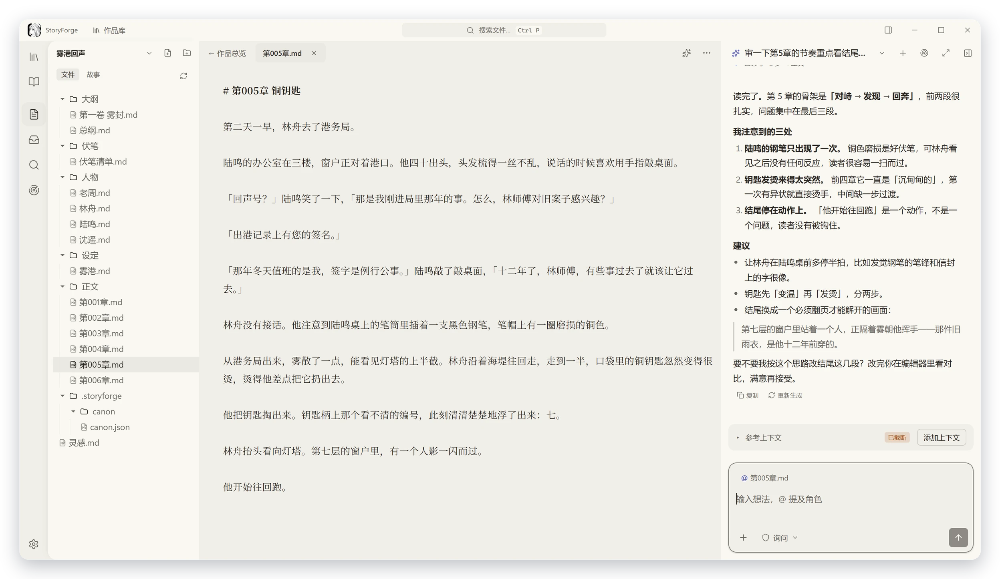
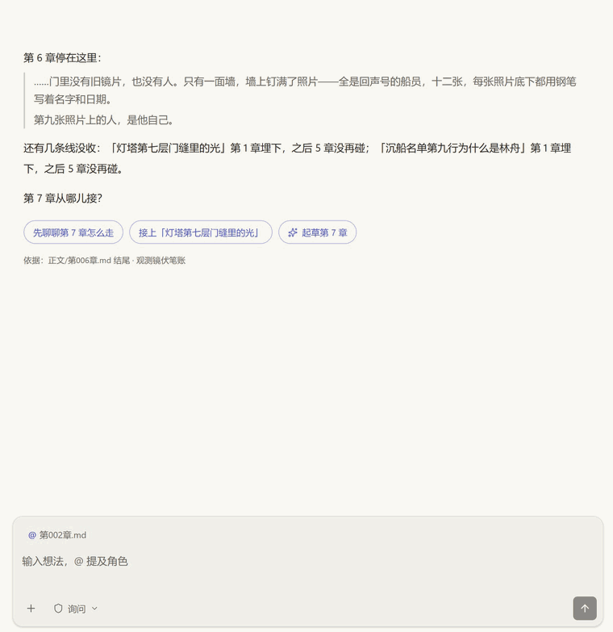
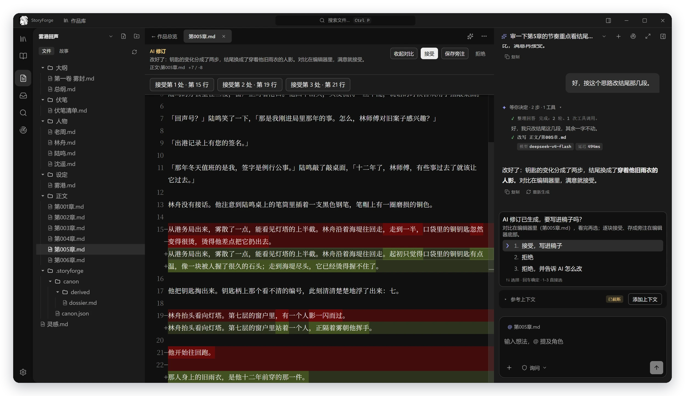
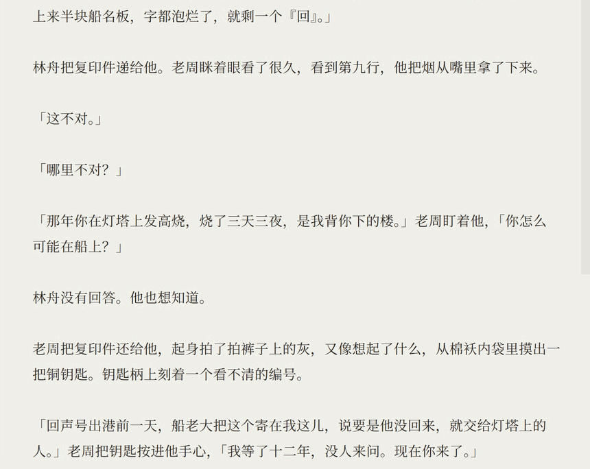
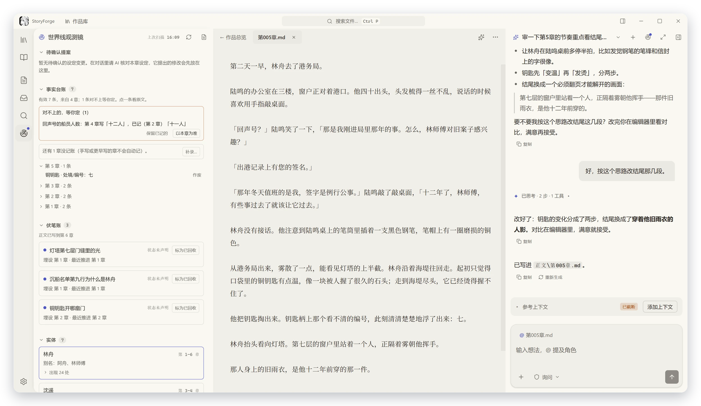
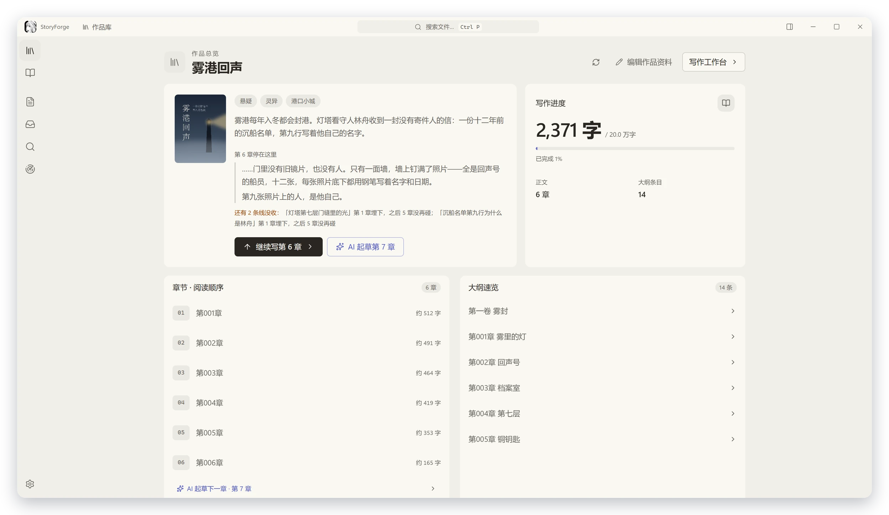
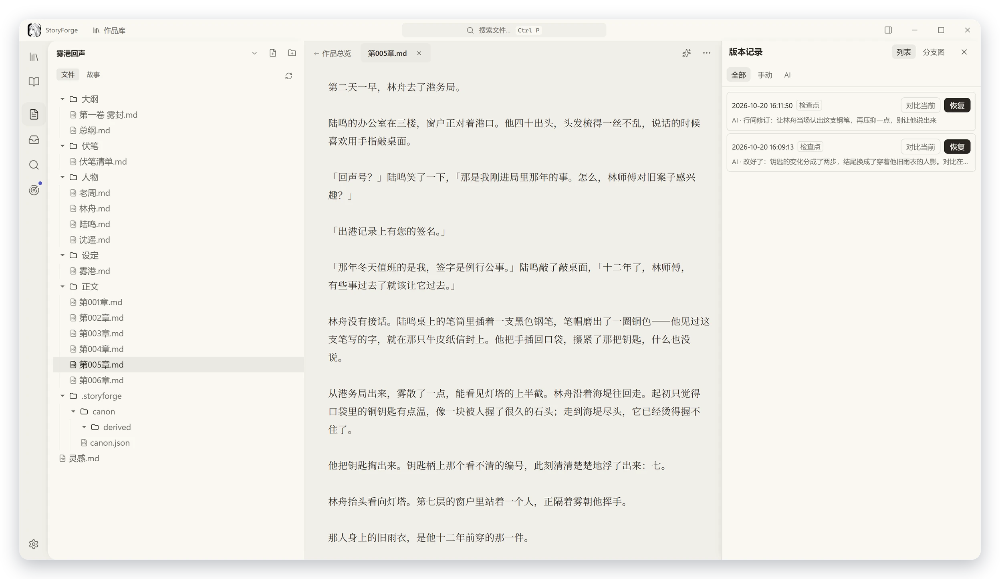
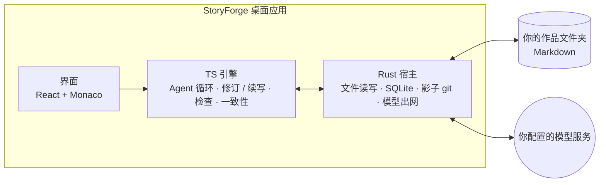

<div align="center">


# StoryForge

**长篇小说作者的 AI 写作 IDE**

在本地打开你的小说项目，和会自己翻查全书的 Agent 一起审稿、改稿、起草。<br />
AI 的每一处修改都以逐字对比交到你面前；默认的「询问」档下，你点头才写进稿子。

[](https://github.com/XZZKANY/StoryForge/releases/latest)
[](https://github.com/XZZKANY/StoryForge/releases)
[](#下载安装)
[](LICENSE)
[](https://github.com/XZZKANY/StoryForge/stargazers)

[**下载安装**](#下载安装) · [**三分钟上手**](#三分钟上手) · [**功能一览**](#功能一览) · [**常见问题**](#常见问题) · [**参与开发**](#参与开发)

**简体中文** · [English](README.en.md)

</div>

<br />

<picture>
  <source media="(prefers-color-scheme: dark)" srcset="docs/assets/readme/hero-dark.webp" />
  
</picture>

<p align="center"><sub>截图中的作品《雾港回声》与 AI 回复均为演示内容。</sub></p>

## 为什么做 StoryForge

写长篇，难的往往不是写出一段漂亮的话，而是写到第八十章还记得第三章埋了什么、谁在哪儿、那把钥匙在谁手里。

通用聊天工具看不见你的整部书，每次都要把前情重新贴一遍；一键生成又把作者挤出了创作。StoryForge 走的是第三条路：

- **你是作者，AI 是编辑和助手。** 它读稿、挑问题、提改法、起草初稿；正文怎么写，默认由你拍板，「询问」档下每个补丁都要你点接受。
- **整部书随时可查。** Agent 会自己翻目录、读章节、全书检索，并参照大纲和人物设定回答你。
- **改动看得见、撤得回。** 对正文的修改都以补丁出现：逐字对比、写前快照、写后一键撤销。

## 功能一览

### 对话式 Agent：一个会自己查全书的编辑



- 直接用中文提要求：「审一下第 5 章的节奏」「第 12 章和第 3 章的设定对得上吗」「起草第 7 章」。
- 要读哪些文件由 Agent 自己决定：列目录、读章节、全书检索，每一步都记在对话里，展开「已思考」就能逐条看。
- 多视角审稿、定向修订、起草新章、跨章一致性检查、深度一致性排查，在同一个对话里完成。
- 说「起草第 7 章」「写下一章」这类话时，先拿章纲给你确认，再写稿、自检，最后以补丁交给你；别的说法可能由 Agent 直接起草，不经章纲。

### 逐字对比，默认你点头才落盘



- AI 对正文的每一次修改都是一个补丁：可以整体接受、逐块接受、直接拒绝，也可以「拒绝，并告诉 AI 怎么改」让它重来。
- 写入前自动存快照，写入后右下角一键撤销。补丁只改它指出的那几处，你在别处的改动会保留；补丁对应的原文已被你改过，就拒绝写入。
- 权限按作品设置：**只读**（只回答，不改正文；连载计划、canon 缓存等 `.storyforge/` 文件仍可能被工具改动）、**询问**（每个补丁都要你点接受）、**自动**（免点击写入，照样留快照、可撤销）。

### 行间协作：Ctrl+K 改写，Ctrl+Shift+K 续写



- 选中一段，按 **Ctrl+K**，说一句「再压抑一点」，改写结果就地出现在原文下方：**Alt+Enter** 接受，**Esc** 放弃。
- 在光标处按 **Ctrl+Shift+K**，按上文的语感接着往下写一段；也可以先给个方向，比如「转到冲突」「慢下来」。

### 世界线观测镜：防吃书



<p align="center"><sub>截图中「船员人数」那条只是示意：现在只有生死、关系、来历前后对不上才会进「等你定」，人数这类会变的状态以新的一章为准。</sub></p>

- **事实台账**：按章纲写章、接受整章补丁后，检查器顺带记下「谁是什么身份、东西在谁手里、船上几个人」这类事实，并注明出处。生死、关系、来历前后对不上的会标出来，等你裁决以哪一章为准；人数、持有这类会变的状态以新的一章为准。手写或更早的章可以在观测镜里补录。
- **伏笔账**：登记在 canon 里的伏笔（你写进去的，或 Agent 提议、你确认并入的）埋在第几章、最近推进到第几章，逾期的会标出来。
- **人物与实体**：登记在 canon 里的人物与实体，本名、别名，出现在哪几章、多少处。
- 伏笔账和人物实体按规则统计，不调用模型；事实台账里的事实由写章检查那次模型调用顺带抽出，老章补录每章要调用一次模型。有疑问时再让 AI 深查。

### 作品总览：打开就知道今天写什么



书封、简介、写作进度、上一章停在哪儿，再提醒最多两条久未推进或已到期的伏笔，一页看完。「继续写第 N 章」「AI 起草下一章」都从这里开始。

### 版本记录与撤销



每次 AI 写回正文都会留下检查点，随时对比、恢复（被作品 `.gitignore` 忽略的文件、超过 2 MB 的未跟踪文件除外）。快照存放在本机的独立影子仓库里，不碰你自己的 git；作品文件夹搬家或改名后，旧版本可能找不回。

### 还有这些

| 功能 | 说明 |
| --- | --- |
| 灵感速记 | 左栏随手记一条，存进作品根目录的 `灵感.md`，编辑器里直接能看、能改 |
| 连载计划 | 每章的目标与进度存在 `.storyforge/serial-plan.json`，Agent 起草时会参考 |
| 知识收件箱 | Agent 提议的设定条目先进收件箱，你审过才写进设定文件 |
| 拆书 | 把一本参考作品拆成结构报告，存成 Markdown 与 JSON |
| 自定义 Agent | 在 `.storyforge/agent-instructions.md` 里写下口吻、审稿口径、风格禁忌 |
| 编辑体验 | 命令面板、全文搜索、多页签、三种布局（Ctrl+1 / 2 / 3）、明暗主题与强调色可调 |

## 下载安装

| 平台 | 安装包 | 说明 |
| --- | --- | --- |
| Windows 10 / 11（64 位） | [**下载最新版**](https://github.com/XZZKANY/StoryForge/releases/latest) | NSIS 安装包，约 33 MB |

- 依赖系统自带的 Microsoft Edge WebView2：Windows 11 已内置，Windows 10 一般也已装好；没有的话，安装程序会联网下载。
- 安装包暂未做代码签名。如果弹出「Windows 已保护你的电脑」，点「更多信息」→「仍要运行」即可。
- 目前只提供 Windows 版本。

## 三分钟上手

1. **安装并打开** StoryForge。
2. **配置模型**：打开「设置 → 模型服务」，选服务商，填入 API key，点保存即生效（兼容 OpenAI 的服务要把服务地址补到 `/v1`，见下文「支持的模型」）。key 加密保存在本机。
3. **打开作品**：在作品库里打开一个本地文件夹作为作品，或者新建一部作品。
4. **开始协作**：在右侧对话框里说出你的需求，或者在编辑器里选中一段按 **Ctrl+K**。
5. **审补丁**：看逐字对比，满意就接受；不满意就拒绝，并告诉它哪里不对。

新建作品时会自动建好推荐的目录结构，稿子都是普通的 Markdown 文件：

```text
我的小说/
├── 正文/        第001章.md、第002章.md……
├── 大纲/        总纲、分卷大纲（左栏会把标题摊成可跳转的目录）
├── 人物/
├── 设定/
├── 世界观/
├── 时间线/
├── 伏笔/
├── 灵感.md      灵感速记（记下第一条灵感时生成）
└── .storyforge/ 作品档案；canon 设定、事实台账、连载计划用到时才生成（由 StoryForge 维护，JSON 格式）
```

## 支持的模型

自带 key，直连服务商，按服务商的价格计费；StoryForge 不经手、不中转。

OpenAI · Anthropic（Claude） · Google Gemini · DeepSeek · 通义千问 · Kimi · SiliconFlow · Ollama（本地模型） · 任何兼容 OpenAI 的接口

- OpenAI、通义千问、Kimi、SiliconFlow、Ollama 等兼容 OpenAI 的服务，要把服务地址补到 `/v1`；Ollama 还要随便填一个非空的 key。
- 走 Anthropic 原生接口时，Agent 的长回复和整章润色受 4096 token 输出上限限制。
- Gemini 下 Agent 的工具调用还没有用真实模型验证过。

主模型之外，还可以给润色单独配一个模型。

## 隐私与安全

- **纯本地**：没有服务端、没有账号、没有遥测。除了你配置的模型服务，还有两类网络请求：正式版启动约 8 秒后向 GitHub 查询最新版本号（只取版本标签，不带稿件内容）；助手回复里如果带图片链接，图片会被直接加载。
- **稿子归你**：稿子就是你文件夹里的 Markdown 文件（`.storyforge/` 里另有 JSON 状态文件），不锁格式、不上传。内容只发给你选的模型：你发起请求时需要的章节和资料；对话变长时，应用还会自动让同一个模型压缩更早的对话。
- **key 不出宿主**：API key 用 Windows DPAPI 加密存在本机，只在 Rust 宿主进程里解密使用；保存之后，界面、日志和数据库里只有占位符。
- **AI 改正文只出补丁**：「询问」档下每个补丁都要你点接受，「自动」档下直接写入；正文写入一律经过「写前快照 → 原子写入 → 版本记录」。连载计划、canon 缓存等 `.storyforge/` 文件由工具直接原子写入，不经补丁、不留快照，「只读」档也一样。

## 常用快捷键

| 快捷键 | 作用 |
| --- | --- |
| `Ctrl+K` | 行间改写（改选中的文字；没选就改光标所在行） |
| `Ctrl+Shift+K` | 光标处续写 |
| `Alt+Enter` / `Esc` | 接受 / 放弃行间建议 |
| `Ctrl+P` | 快速打开文件 |
| `Ctrl+Shift+F` | 全文搜索 |
| `Ctrl+Shift+O` | 世界线观测镜 |
| `Ctrl+Shift+H` | 版本历史 |
| `Ctrl+1` / `2` / `3` | 编辑 / 平衡 / 对话 三种布局 |

## 架构



- **TS 引擎**（`packages/engine`）：Agent 工具循环、修订与续写、章节检查、事实台账、跨章一致性、模型协议，都在桌面窗口里进程内运行。
- **Rust 宿主**（`apps/desktop/src-tauri`）：只管本地副作用——项目边界内的文件读写与原子写、引擎库（SQLite）、模型出网（key 只在这里）、影子 git 快照。
- **界面**（`apps/desktop/frontend`）：Tauri 2 + React 18 + Vite + Monaco Editor。

## 项目状态

StoryForge 目前处于**作者自用打磨阶段**，还不是成熟的商业产品：

- 0.2 起业务逻辑主要在 TS 引擎里，安装包里不再有任何后台服务，约 33 MB。
- 旧版（Python 后端）在真实模型下跑过 1 章和 10 章的小规模生成；0.2 的 TS 引擎只有实验性的真实模型运行，还没有做过验收。更长的连载质量没有验收，**不能宣称稳定产出长篇**。
- 当前阶段的验证记录与能力边界见 [`docs/internal/current-phase.md`](docs/internal/current-phase.md)。

## 路线图

- [x] 编辑器的补丁审阅、写前快照与撤销（撤销覆盖面还有限）
- [x] 后端整体迁到 TS 引擎，安装包从 81 MB 降到 33 MB（0.2.0）
- [x] 事实台账、伏笔账、世界线观测镜
- [ ] 在真实连载里打磨
- [ ] 发布与读者信号回流：把读者反馈沉淀成写作偏好，反哺 Agent

## 常见问题

<details>
<summary><b>它会替我把整本书写完吗？</b></summary>

不会，这也不是它的目标。StoryForge 是给作者用的写作工具：它可以起草一章初稿；默认每次写入都要你点接受，只有切到「自动」档时才直接写盘（写前存快照，可撤销）。
</details>

<details>
<summary><b>我的稿子会被上传吗？</b></summary>

不会上传到任何 StoryForge 的服务器——根本没有这样的服务器。内容只发给你自己配置的模型服务：你发起请求时需要的章节和资料，以及对话变长时自动压缩用的更早对话。
</details>

<details>
<summary><b>要花多少钱？</b></summary>

软件本身免费开源（MIT）。模型费用由你选的服务商按用量收取；用 Ollama 跑本地模型则不产生 API 费用。
</details>

<details>
<summary><b>支持 macOS / Linux 吗？</b></summary>

暂时只有 Windows 版本。key 的加密存储用的是 Windows DPAPI，其他平台还没有适配和验证。
</details>

<details>
<summary><b>我已经用 git 管理稿子了，会冲突吗？</b></summary>

不会改动你的 git 仓库和暂存区：版本快照的内容存在独立的影子仓库里。作品目录的 `.storyforge/` 下会有 StoryForge 的状态文件和版本元数据，它们和稿子一样是普通文件。
</details>

## 参与开发

需要 Node.js 22、pnpm 9.15.4、Rust 工具链，以及 Tauri 2 的 Windows 构建依赖。

```powershell
git clone https://github.com/XZZKANY/StoryForge.git
cd StoryForge
pnpm install
npm --prefix apps/desktop/frontend install
pnpm dev               # 启动桌面应用（Vite + Tauri 窗口）
```

```powershell
pnpm verify            # 提交前的总门禁：lint、类型检查、引擎与前端测试、三个浏览器回归
pnpm test              # 再加上 Rust 测试与 Tauri 冒烟
pnpm desktop:build     # 打 NSIS 安装包
```

Windows PowerShell 若拦截 `pnpm.ps1`，改用 `pnpm.cmd`。更多说明见 [本地开发](docs/operations/local-start.md)、[故障排查](docs/operations/troubleshooting.md) 与 [发版清单](docs/operations/release-checklist.md)。

```text
StoryForge/
├── apps/desktop/
│   ├── frontend/      界面（React + Monaco）
│   └── src-tauri/     Rust 宿主
├── packages/
│   ├── engine/        TS 引擎
│   └── project-core/  路径围栏等共享内核
├── docs/              架构、阶段事实源、运维手册
└── scripts/           本地门禁与生成脚本
```

欢迎提 Issue 和 PR。提交前请至少跑一遍 `pnpm verify`；不要提交真实的 API key 或未脱敏的运行日志。更多工程约定见 [`CLAUDE.md`](CLAUDE.md)。

## Star 趋势

<a href="https://star-history.com/#XZZKANY/StoryForge&Date">
  <picture>
    <source media="(prefers-color-scheme: dark)" srcset="https://api.star-history.com/svg?repos=XZZKANY/StoryForge&type=Date&theme=dark" />
    
  </picture>
</a>

## 许可证

[MIT](LICENSE) © XZZKANY
